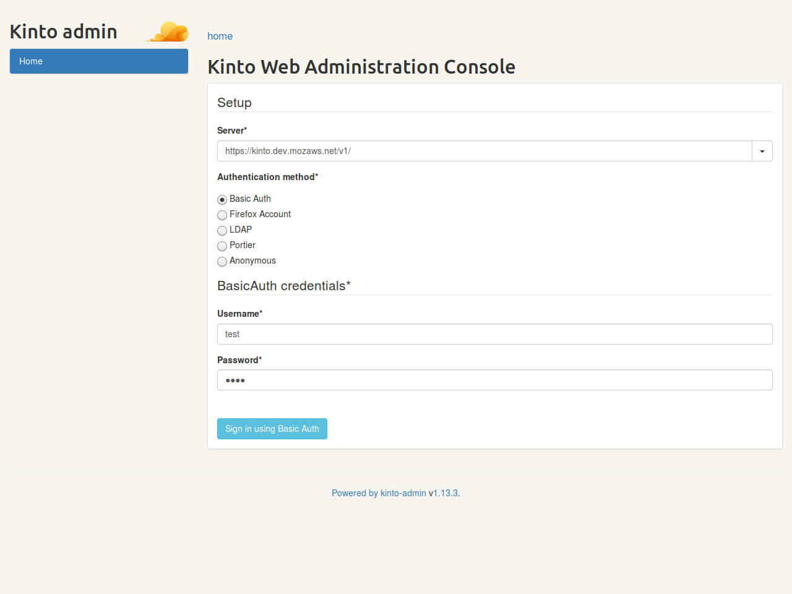
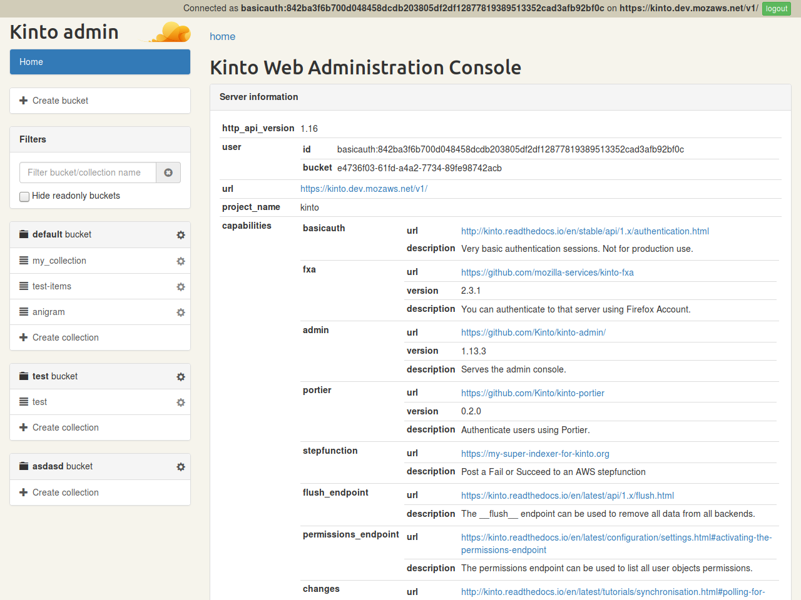
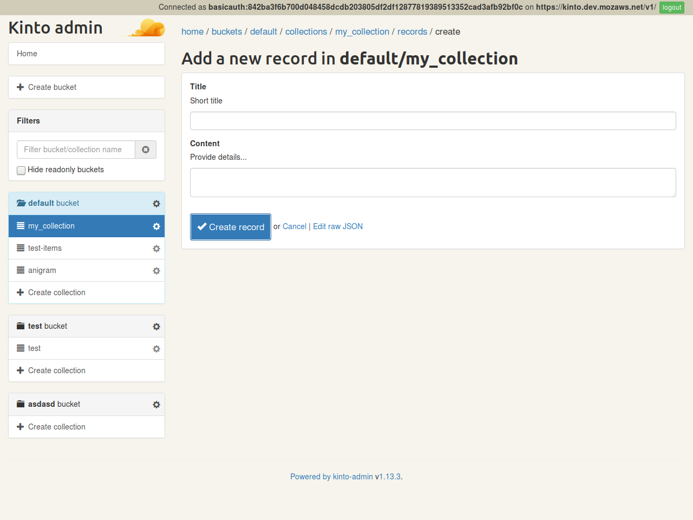
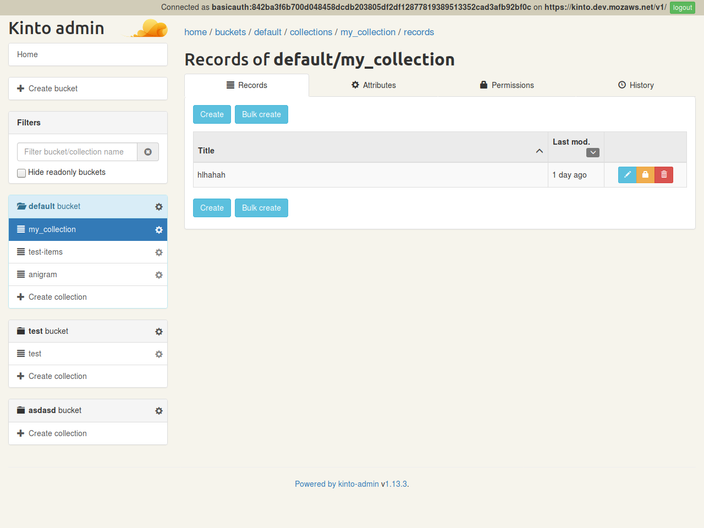

.. _kinto-admin:

Kinto Admin
###########

When the built-in plugin ``kinto.plugins.admin`` is enabled in
configuration, a Web admin UI is available at ``/v1/admin/``.

+-----------------------------+----------+-------------------------------------------------+
| Setting name                | Default  | What does it do?                                |
+=============================+==========+=================================================+
| kinto.admin_assets_path     | None     | Absolute path to the Admin UI assets files.     |
|                             |          | The folder must contain an ``index.html`` file. |
|                             |          | and a ``VERSION`` file.                         |
+-----------------------------+----------+-------------------------------------------------+
| kinto.admin_csp_connect_src | ``""``   | Space separated list of additional origins the  |
|                             |          | Admin UI is allowed to ``fetch()`` from, added  |
|                             |          | to the ``connect-src`` directive of its         |
|                             |          | Content-Security-Policy                         |
|                             |          | (eg. ``https://cdn.example.com``).              |
|                             |          | Also exposed in the ``admin`` capability as     |
|                             |          | ``csp_connect_src``.                            |
+-----------------------------+----------+-------------------------------------------------+

To enable attachment diffs in the Admin UI when attachments are served from a
different origin, add that origin to ``kinto.admin_csp_connect_src``, and
configure the attachments host to allow CORS ``GET`` requests from the Kinto
server's origin.

* `See dedicated repo <https://github.com/Kinto/kinto-admin/>`_

